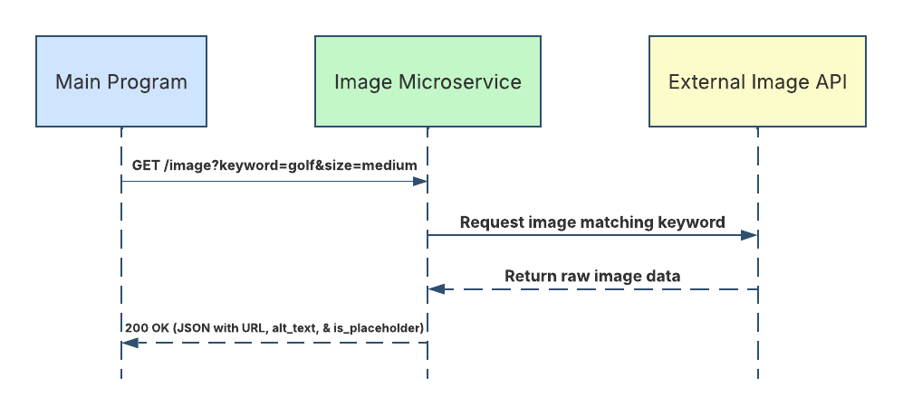

# Image-Microservice-Sprint2
A universal REST API that fetches relevant images and descriptive alt-text based on user-provided keyword searches.

The Image Microservice receives a keyword and an optional size parameter, and returns a structured JSON response containing a relevant image URL and descriptive alt-text. If an image cannot be found for the provided keyword, the microservice gracefully returns a safe fallback placeholder image to prevent broken UI elements.

### Communication Pipe
REST API (HTTP GET requests with JSON responses)

### Requesting Data
The microservice runs locally and listens on a port (for example, `http://localhost:5004`). To request an image, the main program sends an HTTP GET request to the `/image` endpoint. 

**Parameters:**
- `keyword` (Required): A string representing the search term (e.g., "golf").
- `size` (Optional): A string specifying the requested image size (`small`, `medium`, or `large`). Defaults to `medium` if omitted or invalid.

**Request Example:**
```python
import requests

url = "http://localhost:5004/image"
request_params = {
    "keyword": "golf",
    "size": "large" 
}

response = requests.get(url, params=request_params)
```

### Receiving Data
The microservice sends back an HTTP response with a JSON body. The body contains the original search keyword, the resulting image URL, descriptive alt-text for accessibility, and a boolean flag indicating if the result is a fallback placeholder.

**Expected JSON Format:**
```json
{
    "keyword_searched": "golf",
    "image_url": "https://example.com/images/golf.jpg",
    "alt_text": "A person swinging a golf club on a green course",
    "is_placeholder": false
}
```

**Receive Example:**
```python
response_data = response.json()

if response.status_code == 200:
    print("Keyword:", response_data["keyword_searched"])
    print("Image URL:", response_data["image_url"])
    print("Alt Text:", response_data["alt_text"])
    
    if response_data["is_placeholder"]:
        print("Note: This is a fallback placeholder image.")
else:
    print("Request failed:", response_data.get("error"))
```


### UML Sequence Diagram
